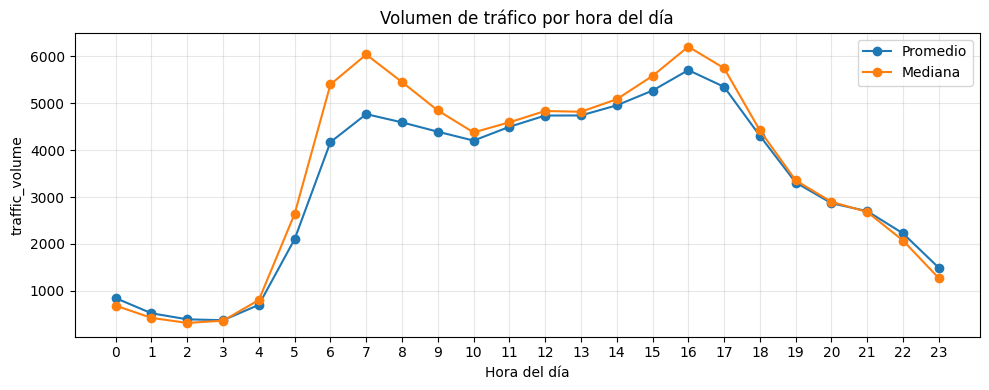
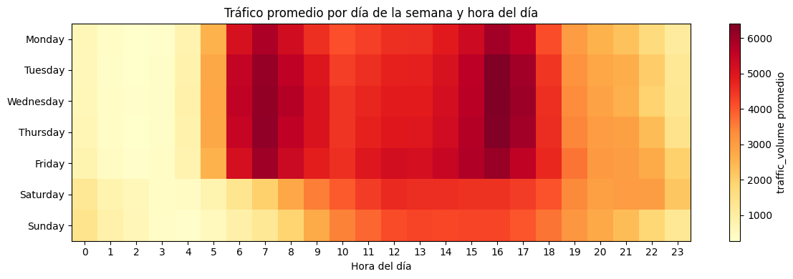
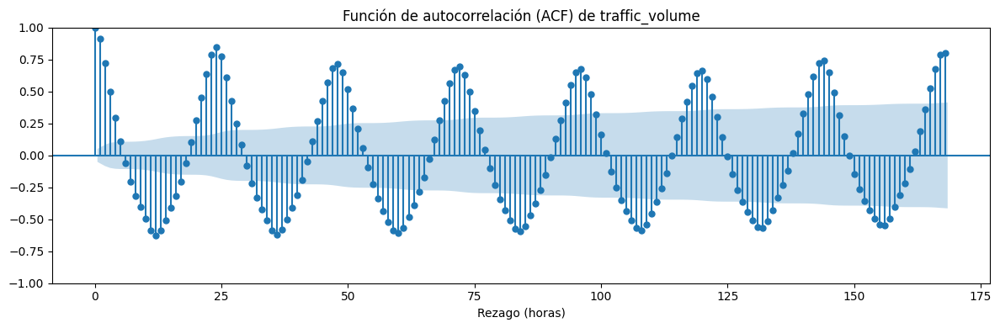
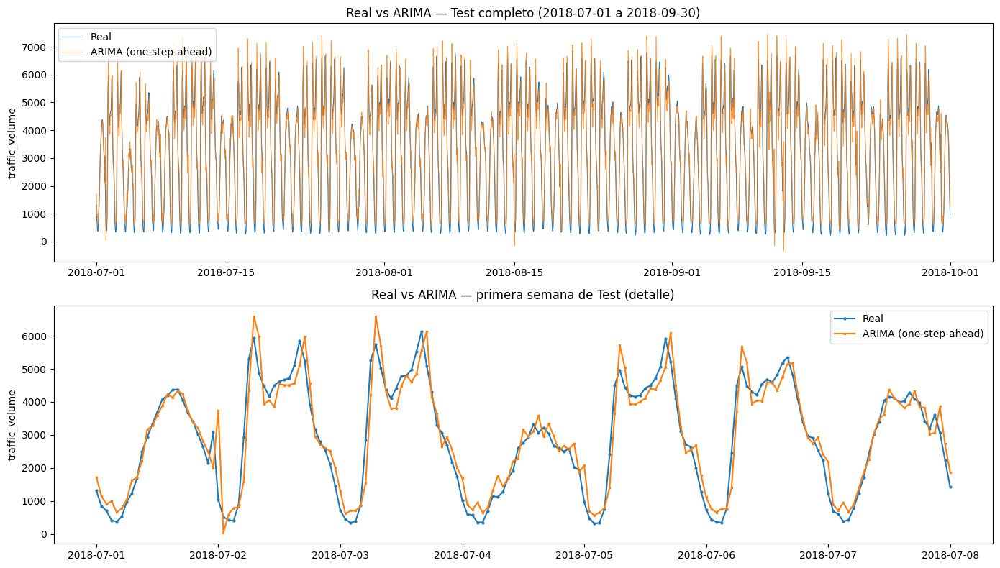
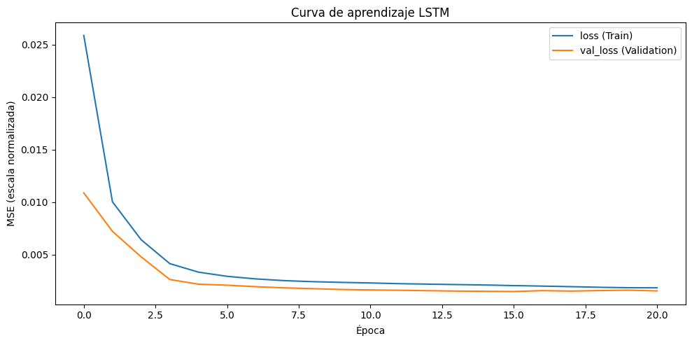
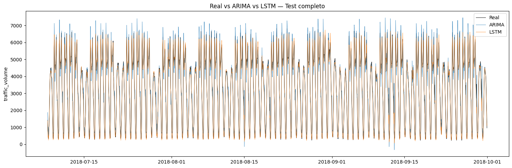
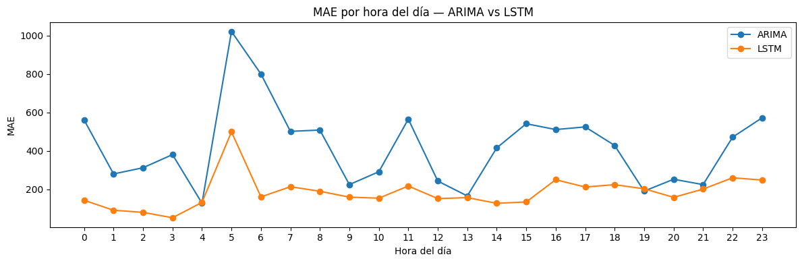

# Predicción de tráfico vehicular con ARIMA y LSTM

**Universidad de La Salle — Maestría en Inteligencia Artificial**
**Machine Learning (Grupo 01) — Actividad 4: Modelos de predicción con series temporales**
Autor: Ing. Camilo Andrés Castañeda Galindo

[](https://colab.research.google.com/drive/1983h5__q8q6ax71DgFFBxXjDWQW9pUYd?usp=sharing)

---

## Descripción

Este proyecto pronostica el **volumen horario de tráfico vehicular** (`traffic_volume`) registrado en la interestatal Metro (Minneapolis–St Paul) y compara dos enfoques:

- **ARIMA**: modelo estadístico clásico.
- **LSTM**: red neuronal recurrente con Keras/TensorFlow.

Ambos se evalúan con un protocolo **estrictamente cronológico y sin fuga de información** y se comparan con baselines ingenuos (`t-24` y `t-168`). También se analiza el desempeño en **horas pico**.

**Dataset:** [Metro Interstate Traffic Volume (Kaggle)](https://www.kaggle.com/datasets/mikedev/metro-traffic-volume). El CSV no se incluye en el repositorio; descárgalo y colócalo en la raíz del proyecto como `Metro_Interstate_Traffic_Volume.csv`.

## Flujo de trabajo

1. **Auditoría y preparación**: 48.204 filas, consolidación de 5.445 timestamps duplicados y detección de un hueco de 7.386 h (ago-2014 a jun-2015), que no se interpola.
2. **Período de modelado**: 2017-01-01 a 2018-09-30 (cobertura > 99,5 %), regularizado a frecuencia horaria. Las 66 horas faltantes se imputan con medianas por día de la semana y hora calculadas solo con Train.
3. **División cronológica**: Train (10.920 h), Validation (2.184 h) y Test (2.208 h).
4. **EDA**: ciclo diario bimodal (picos ≈07:00 y ≈16:00), caída los fines de semana y fuerte autocorrelación cada 24 h.
5. **ARIMA**: prueba ADF (`d=0`), ACF/PACF y selección por RMSE en Validation, con **ARIMA(2,0,0)** como mejor modelo. La evaluación en Test es *walk-forward* one-step-ahead.
6. **LSTM**: `MinMaxScaler` ajustado solo con Train, ventanas de 168 h y arquitectura `LSTM(50) → LSTM(50) → Dense(25) → Dense(1)` con `EarlyStopping`.
7. **Comparación y horas pico**: el umbral de pico es el percentil 90 de Train (5.858 vehículos/h).
8. **Pronóstico ilustrativo** recursivo de 24 h con la LSTM.

## Resultados principales

Métricas sobre la misma ventana de Test (2.036 horas observadas):

| Modelo | MAE | MSE | RMSE |
|---|---:|---:|---:|
| Baseline (t-168) | 235,27 | 241.678,60 | 491,61 |
| ARIMA(2,0,0) | 421,85 | 304.832,20 | 552,12 |
| **LSTM** | **184,35** | **69.161,39** | **262,99** |

Error en horas pico:

| Modelo | MAE en picos | MAE fuera de picos |
|---|---:|---:|
| ARIMA(2,0,0) | 656,02 | 399,96 |
| **LSTM** | **214,27** | **181,56** |

**Conclusión:** la LSTM fue el mejor modelo, con alrededor de un 50 % menos de error, y mantiene su ventaja en horas pico. ARIMA, al no ser estacional, apenas iguala al baseline semanal y falla en las transiciones de madrugada a hora pico.

## Imágenes de referencia

### Patrón horario del tráfico


### Mapa de calor hora × día de la semana


### Autocorrelación (ACF)


### ARIMA sobre Test


### Curva de aprendizaje de la LSTM


### Comparación Real vs ARIMA vs LSTM


### MAE por hora del día


## Estructura del repositorio

```text
├── images/      # Gráficas de referencia generadas por el notebook
├── notebook/
│   └── Actividad_4_Prediccion_Trafico_ARIMA_LSTM.ipynb
└── README.md
```

## Ejecución

Requisitos principales: Python 3, `numpy`, `pandas`, `matplotlib`, `statsmodels`, `scikit-learn` y `tensorflow`. Las versiones usadas fueron numpy 1.26.4, pandas 2.3.3, statsmodels 0.15.0 y tensorflow 2.20.0.

```bash
pip install numpy pandas matplotlib statsmodels scikit-learn tensorflow
jupyter notebook notebook/Actividad_4_Prediccion_Trafico_ARIMA_LSTM.ipynb
```

## Limitaciones y trabajo futuro

- Los modelos son univariados: no incluyen clima ni festivos.
- ARIMA no modela la estacionalidad diaria ni la semanal. Como trabajo futuro se proponen SARIMA/SARIMAX y variables exógenas.
- Los hiperparámetros de la LSTM no se exploraron exhaustivamente.
